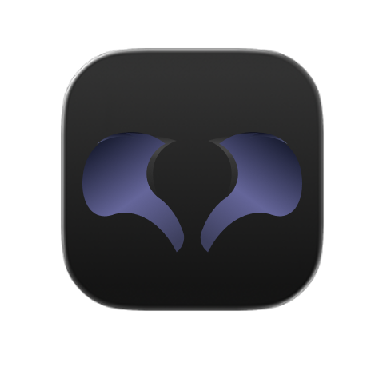
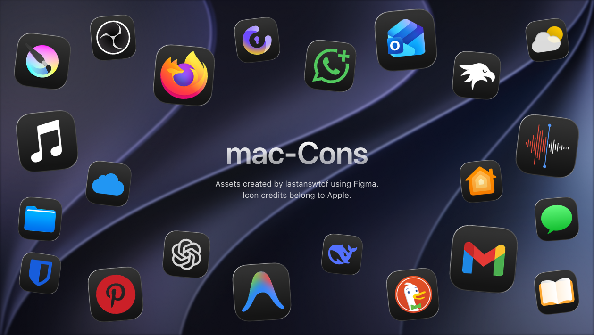

# mac-Cons

**Dark mode app icon library for Apple design, on your own device!**

  

---

## About

**mac-Cons** is a library of app icons in **dark mode**, made for Apple design. Think of it as a database of Apple icons that you can use to style your own device.

Besides Apple icons, the project also contains icons for **other apps**, so there is a wide variety to choose from.

---

## What is included

| Category | Details |
|:---|:---|
| **Apple icons** | Official Apple icons in dark mode |
| **Recreations** | Recreations of official icons, made by me in Figma |
| **Other apps** | Icons for apps outside the Apple ecosystem |

---

## Project details

| Field | Details |
|:---|:---|
| **Project** | mac-Cons |
| **Author** | lastanswtcf |
| **Theme** | Dark mode |
| **Made with** | Figma |
| **Purpose** | Personal use, to style your own device |
| **Uploads** | Author only |

---

## Terms of use

> [!IMPORTANT]
> These icons are for **personal use on your own device only.**

| Usage | Status |
|:---|:---|
| Personal use on your own device | Allowed |
| Commercial use of any kind | Not allowed |
| Re-uploading the icons to websites | Not allowed |
| Selling the icons | Not allowed |
| Subscriptions or any paid access to the icons | Not allowed |

> [!WARNING]
> Violating these terms may result in a takedown request.

---

## License

> [!IMPORTANT]
> Before using anything from this project, **read the LICENSE file in this repository carefully.** It contains the full terms of use.

---

## No partnerships

> [!NOTE]
> This project has **no partnerships** and is **not affiliated** with any company. All names, logos, and icons belong to their respective owners.
